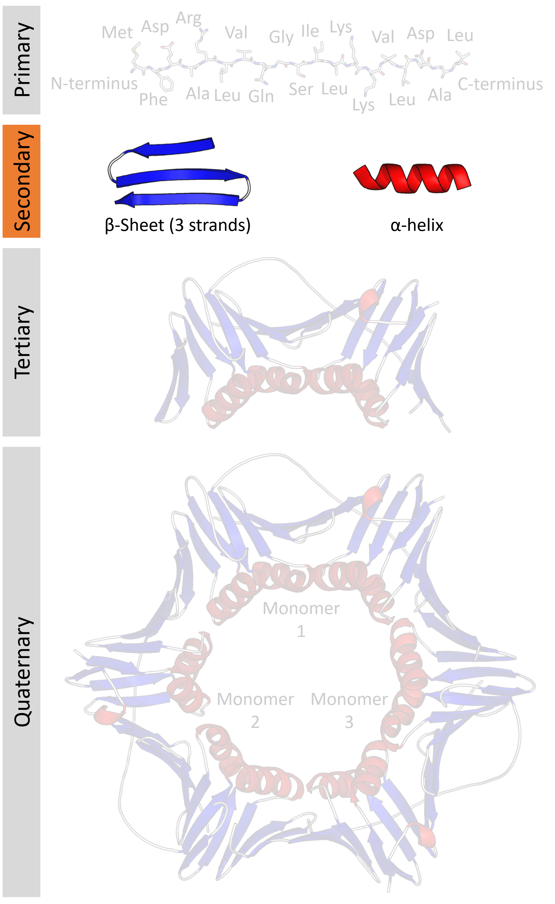
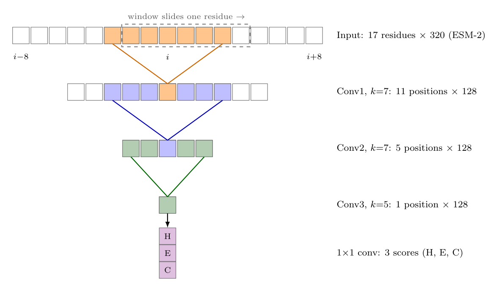
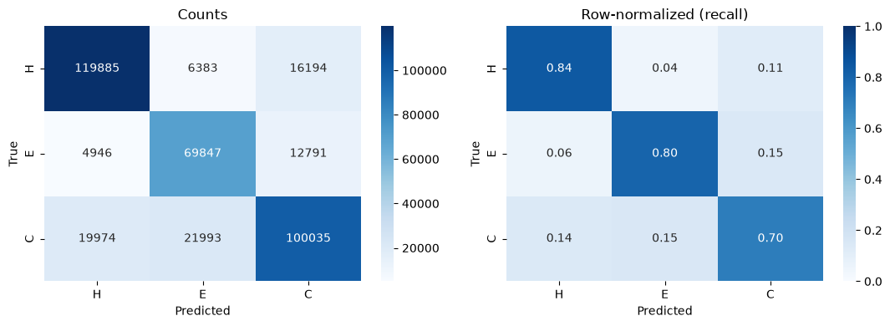

# Protein Sequence to Secondary Structure Prediction

## Task Description

In structural biology the task of predicting protein structure was hailed as one of the legendary problems of the millenium. Other structures like nucleic acids, with only 4 possible bases, have very simple rules to their structure, but proteins have 20 amino acids each with their own very unique properties. This space has proven to be very hard to explore with analytical methods.

For instance a length 10 nucleic acid has $10^4$ combinations but a protein would have $10^{20}$ combinations, 16 orders of magnitude larger.

The 2024 Nobel Prize in Chemistry was awarded for deep learning methods in protein structural prediction. This new field aims to predict complex 3D global (teriary) structure and multisystem (quaternary) structure. This requires very complex model architectures and legendary compute that are unachievable for an undergraduate student to achieve at the TACC for such a project. I aim to do a smaller and far more managable task: predict local interactions (secondary structure) from sequence alone.

[By Thomas Shafee - Own work, CC BY 4.0](https://commons.wikimedia.org/w/index.php?curid=52821069)

## Dataset Creation

In biology perhaps the most comprehensive database is the [Protein Data Bank (PDB)](https://www.rcsb.org/) containing roughly 250,000 resolved structures. Many of these structures however are low quality in sequence determination or in structural resolution. Additionally as it is biology are evolutionarily related, making independent sample collection difficult.  

Fortunately the PDB has their own reduced dataset for training that only has 25% similarity.

Additionally, the Dunbrack lab at the Fox Chase Cancer Center has created an amazing compiling tool called [PISCES](https://dunbrack.fccc.edu/pisces/PISCES_OptionPage.php). That allows me to filter this dataset for the highest quality structures.

I specifically chose:
- 25 maximum pairwise percent sequence identity
- Maximum Resolution of 2.0 Å
- Maximum R value 0.25
- Minimum chain length: 40
- Maximum chain length: 500
- Only include entries from X-ray

This dataset contained 8,704 PDB IDs and Chain IDs of the structures in this repository as `selected_chains.txt`. However, I had to then download these structures from the PDB, which after 1 hour on my laptop, I had 8,636 structures.

These structure files come in a `.cif` format, which details the 3D coordinates of each atom in the structure and their relationships (bonds) to each other. To get secondary structure labels I had to use the field standard program [DSSP](https://github.com/PDB-REDO/dssp), which provides 9 labels for secondary structure:
- $\alpha$-Helix (H)
- $3_{10}$-Helix (G)
- $\pi$-Helix (I)
- $\beta$-Sheet (E)
- $\beta$-Bridge (B)
- Hydrogen-Bonded Turn (T)
- High Curvature (S)
- Polyproline II Helix (P)
- Coil/Loop (C)

For this project I decided to reduce this to 3 simple labels: 
- H,G,I &rarr; Helix (H)
- E,B &rarr; Sheet (E)
- T,S,P,C &rarr; Coil (C)

This dataset can be found in `selected_proteins.csv`.

## Model

Classifying the secondary structure of each residue position in a sequence is a complicated task. Local neighborhoods of residues effect each other's probabilities of being in one of the 3 structural states.

For instance in a helix, every turn should be 3.6 residues, sheets are around 5-10 residues in length, and loops are around 3-10 residues long.

To solve this problem, I hot encoded each of the 20 amino acids plus a miscellaneous residue "X", and use a sliding window of 17 positions, which is passed into a 1D-Convolutional Neural Network with a final softmax function for classification, all coded in pytorch.

Additionally, I replaced the hot encoding with a transformer encoder called [ESM-2](https://huggingface.co/facebook/esm2_t6_8M_UR50D) that provides more complex representations of the residues, based in far more training. This model fairly accurately predicts secondary structure of proteins based solely on sequence information.

## Limitations

- I grouped many secondary structures together to create the 3 label classes, however this is not close to reality and compared to other structures the model has decreased accuracy and precision in predicting loops (C).
- This model is also not trained on accurate representations of non-canonical residues (not the standard amino acids) as it maps these to a miscellaneous "X" residue.

## Files

The dataset was created using the `protein_dataset.ipynb` notebook. This uses the `selected_chains.txt` for the downloaded PDB `.cif` files contained in the `Structures/` directory I decided not to upload for size. I then use the `dssp` github repository and compiled the program using CMake and feed the path in the notebook. The final dataframe is saved in `selected_proteins.csv`.

This data is then explored in the `structure_classifier.ipynb` notebook. First hot encoding the sequence and then encoding the structure labels. Finally this is split into training and testing data. 

I then train the softmax classifier using the `softmax_ss.py` module and finally train the 1D CNN using the `CNN_ss.py` module.

## Conda Environments

Each workflow contains its own conda environment as some of the packages are either incompatible or very large. The workflows follow with the directories

1. Dataset Creation (protein_dataset_env): 
- Biopython
- pandas
- DSSP

2. Model Development (structure_classifier_env):
- pytorch
- pandas
- numpy
- matplotlib
- scikit-learn
- transformers
- torchview
- graphviz
- seaborn